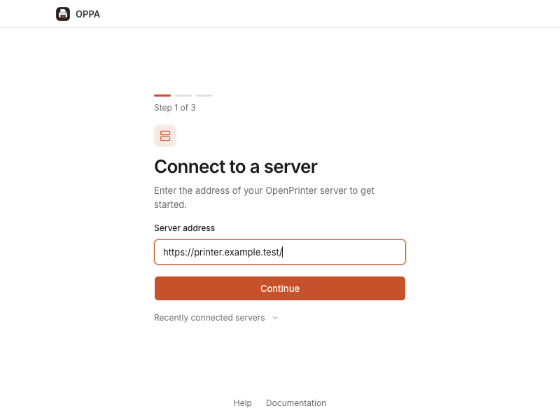
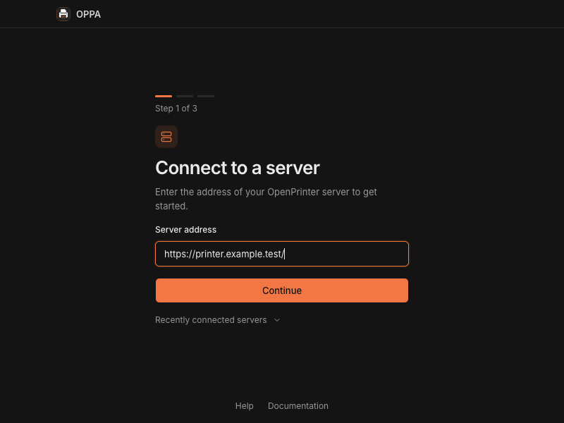
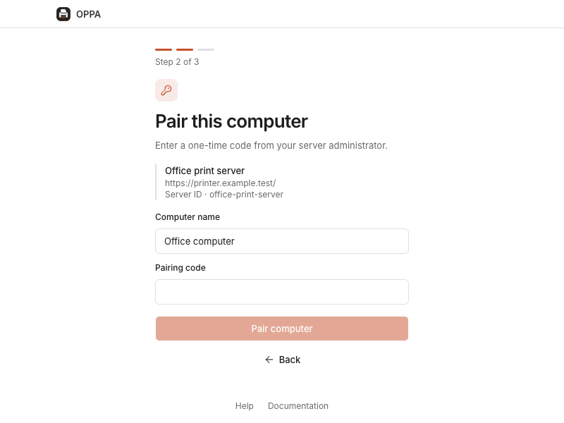
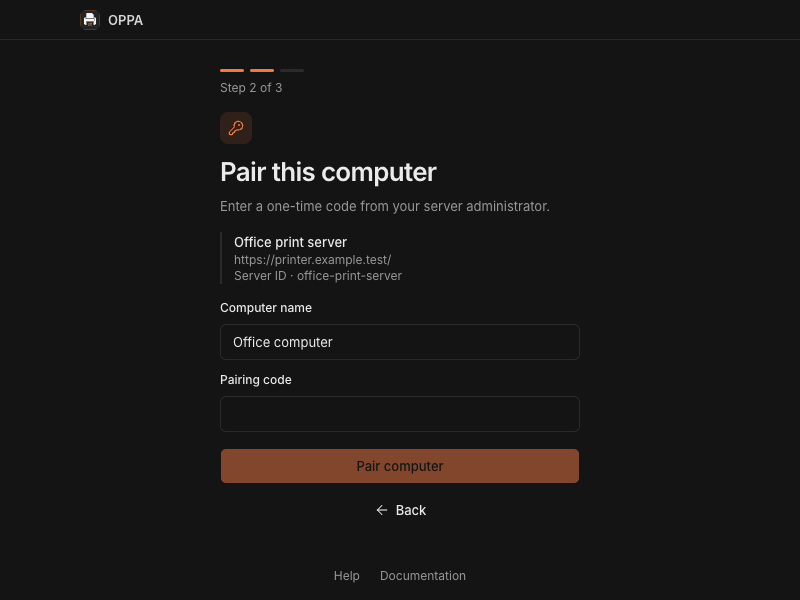
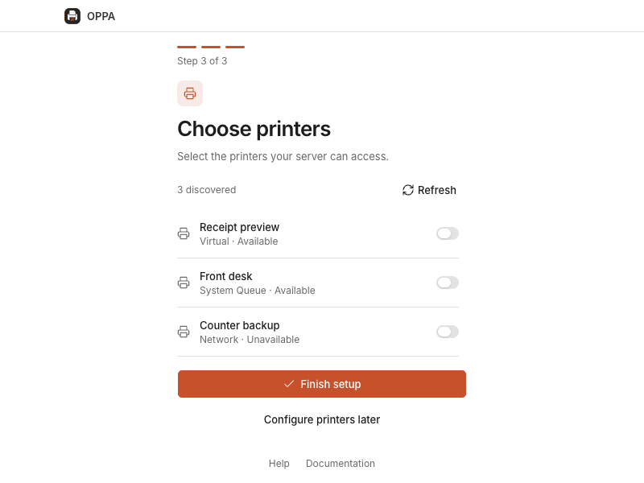
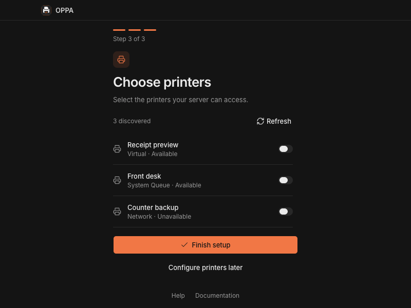

# Design foundation and onboarding review

This document records the approved phase 1 and 2 review. Later phases are documented in
[the desktop review](desktop/README.md). At the time of this snapshot, the scope stopped at phases 1 and 2. The application shell navigation and the overview, printers,
jobs, virtual printers, logs, settings, and tray retain their previous layouts and operations.
Shared typography, tokens, control geometry, and focus styling apply throughout the app.

## Visual direction

A 360 px workspace sits directly on the background. Progress, a small functional icon, a clear
heading, and one primary action establish hierarchy. Server identity uses a simple left rule;
printer rows use subtle separators. There are no promotional panels, enclosing cards, gradients,
or decorative badges. The existing title bar has an onboarding-only minimal mode, preserving
platform menus, drag regions, and window controls. Windows retains its 44 px control host;
other onboarding title bars are 40 px.

The requested palette is used, with the light accent adjusted from `#C45B26` to `#BF5723` so white
button text reaches a contrast ratio of approximately 4.56:1. Dark accent text uses the dark
background as its foreground. Semantic success, warning, and error tokens remain independent.

Actual reference screenshots inspected:

- [Linear preferences](https://linear.app/docs/account-preferences): compact labels and surface separation.
- [Raycast settings](https://manual.raycast.com/settings): consistent controls and concise descriptions.
- [Tailscale desktop interface](https://tailscale.com/blog/macos-notch-escape): direct operational language.
- [TablePlus connection dialog](https://tableplus.com/blog/2018/09/sequel-pro-windows-is-it-available-yet.html): focused connection inputs and actions.

## Rendered screenshots

All six primary captures below are actual application renders at **800×600** using the isolated
development fixture, with the production React components and mocked agent operations.

| Step | Light | Dark |
| --- | --- | --- |
| Connect |  |  |
| Pair |  |  |
| Printers |  |  |

Additional inspected renders:

- [Discovery error](screenshots/discovery-error-800x600.png)
- [Expired pairing code](screenshots/pairing-error-800x600.png)
- [Thirty printers with internal scrolling](screenshots/long-list-800x600.png)
- [No discovered printers](screenshots/empty-printers-800x600.png)
- [1024×768](screenshots/pair-1024x768.png)
- [1280×800](screenshots/printers-1280x800.png)
- [1600×1000](screenshots/connect-1600x1000.png)

## Flow and security

The reducer represents exclusive connect, pair, and printer-selection stages. Only successful
agent operations advance the flow. Back navigation preserves entered values for the same server;
editing the server address discards its previous pairing code and identity. Manually entered codes are normalized
on paste; opaque deep-link keys retain their exact casing. Codes are never persisted. Restarted pairing re-discovers the server before enabling submission.
Only the stage, address, and computer name persist in local view preferences.

Existing pairings require confirmation before their credential is removed using the existing
agent operation. Validated deep links skip address entry and populate the code in memory, while
still requiring discovery and explicit verification before pairing. Authentication and revocation
states offer recovery; temporary connection loss does not erase the form.

The current backend enables newly discovered printers. Before creating a new pairing, onboarding
uses existing configuration operations to disable printer access so the user can explicitly enable
it in step 3. Refreshing in step 3 similarly disables new arrivals while preserving existing choices.
No protocol, metric, backend feature, credential-storage, or delivery changes were introduced.

## Validation

- Formatting, workspace ESLint, workspace Clippy with all targets/features, and workspace type checks passed.
- All JavaScript suites passed, including five onboarding reducer/persistence tests.
- Desktop Rust host tests passed (20 tests).
- OPPA production frontend build passed; Vite reports its existing single-chunk size advisory.
- Browser acceptance checks passed 24 layouts: three steps × two themes × four sizes
  (800×600, 1024×768, 1280×800, 1600×1000).
- Each layout maintains a 360 px column, no document overflow, and accessible footer/actions.
- Browser interactions covered discovery, normalized code entry, Back, pairing, explicit enabling,
  completion, deep links, safe restart, empty results, revoked credentials, authentication recovery,
  and cancellation of server replacement. No browser runtime errors were reported.

Rust checks used the installed `1.99.1` toolchain because this machine's `stable` alias could not
run `rustc`/`rustfmt`. The larger desktop capture used headless Chrome after the shared preview
could not draw a viewport larger than 1280×800.

## Reproducing the review

```bash
pnpm --filter oppa dev --host 127.0.0.1
pnpm --filter oppa test
```

Open `/test/onboarding.html?step=connect&theme=light` on the Vite server. `step` accepts `connect`,
`pair`, or `printers`; `theme` accepts `light` or `dark`. Optional flags include `discovery-error`,
`pair-error`, `empty`, `long`, `deep-link`, and `resume`. This HTML fixture is not a production build
entry point and no test-only controls or data are imported by the production application.

For the optional browser acceptance script, provide an existing Playwright installation through
`OPPA_PLAYWRIGHT_MODULE` (or make `playwright` available to Node) and run
`node apps/oppa/test/onboarding.browser.mjs`. It uses installed Chrome and adds no application dependency.

## Remaining platform validation

Browser fixtures verify rendered UI and interaction behavior. Live Tauri menus, native window
controls, deep-link OS registration, secure credential storage, and real server/printer operations
still need platform runtime acceptance testing. The native minimum width is now 800 px to match
the reviewed smallest size; hide-to-tray and process-lifecycle behavior are unchanged.
